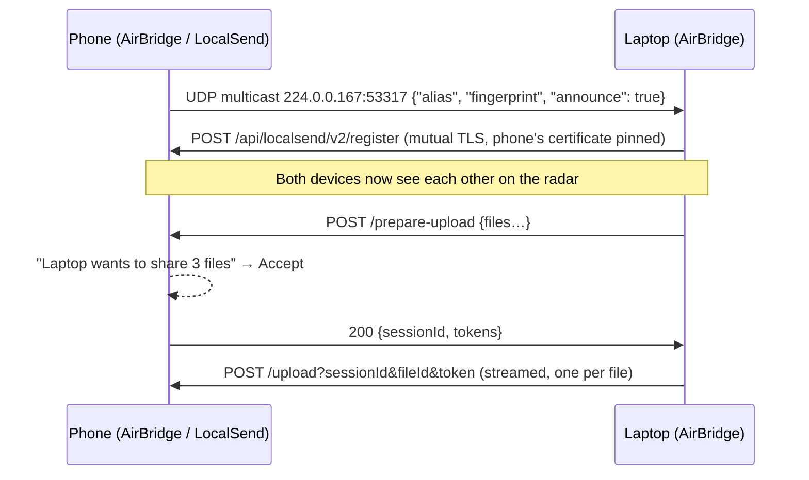

# AirBridge

**AirDrop-style sharing between your Linux computer and your Android phone.**
Drop a file on your phone's bubble and it arrives. Send links, notes and the clipboard in one tap.
There is no cloud, no cable and no account. Both apps are animated: orbiting device bubbles,
progress rings, particle streams and confetti.

<p align="center">
  
  
</p>

AirBridge speaks the open **[LocalSend](https://github.com/localsend/localsend) v2 protocol**, so it
also works with the official LocalSend apps (Windows, macOS, iOS, Android, Linux). Why not real
AirDrop or Google Quick Share? See **[docs/RESEARCH.md](docs/RESEARCH.md)**.

## What's inside

| Part | Tech | Highlights |
|---|---|---|
| **Linux app** (`linux/`) | Rust (tokio, axum, rustls) + an embedded web UI | Radar UI, drag & drop, tray icon, notifications with Accept/Decline, CLI, file-manager "Send with AirBridge" |
| **Android app** (`android/`) | Kotlin + Jetpack Compose | Same radar UI, share-sheet target, Quick Settings tile, background receiving, notification actions |
| **Phone browser companion** | Served by the Linux app | A phone with *no app at all* scans a QR code and shares through its browser |

### Features

- **Find devices automatically**: multicast discovery on your Wi‑Fi, with a "Scan network"
  fallback for routers that block multicast.
- **Files, folders, photos, text and clipboard**, in both directions. Folders keep their structure.
- **Accept or decline** from the app or straight from the notification. **Trusted devices** (your
  own phone) are accepted automatically.
- **Animations everywhere**:
  - Pulse rings and a radar sweep
  - Device bubbles that spring in, float and glide into place
  - Gradient progress rings and particles flowing between devices during a transfer
  - Confetti when a transfer finishes, shake on failure, spring-animated sheets
  - Reduced-motion settings are respected
- **Secure by default**: TLS everywhere, certificates pinned by fingerprint, mutual TLS, an
  optional PIN, and the clipboard only accepts text from trusted devices.

<table>
<tr>
<td></td>
<td></td>
</tr>
<tr>
<td></td>
<td></td>
</tr>
</table>

<p align="center">
  
  
  
  
  
</p>

## Install

### Linux

You need [Rust](https://rustup.rs) 1.89 or newer. For a native app window, also install WebKitGTK.
Without it, AirBridge opens in a Chromium app window or your default browser.

```bash
# Debian/Ubuntu (optional, for the native window)
sudo apt install libwebkit2gtk-4.1-dev libgtk-3-dev libxdo-dev
# Fedora:  sudo dnf install webkit2gtk4.1-devel gtk3-devel libxdo-devel

git clone https://github.com/MDHaarith/Linux-Android-AirDrop
cd Linux-Android-AirDrop/linux
./packaging/install.sh
```

The installer puts `airbridge` in `~/.local/bin` and adds:

- an app-menu entry
- autostart at login (it stays visible to your phone in the background)
- a tray icon
- "Send with AirBridge" in Nautilus, Dolphin and Nemo

If a firewall is active, the installer prints the exact commands to open the ports. You can also
open them yourself:

```bash
sudo ufw allow 53317/tcp && sudo ufw allow 53317/udp && sudo ufw allow 53318/tcp
```

Optional tools: `wl-clipboard` (Wayland) or `xclip`/`xsel` (X11) for clipboard sharing, and
`xdg-desktop-portal` or `zenity` for the file picker.

### Android (10 or newer)

Download the APK from a [release](../../releases) or from the latest CI run (artifact
`airbridge-android-apk`), or build it yourself:

```bash
cd android
./gradlew assembleRelease   # → app/build/outputs/apk/release/app-release.apk
```

Install it, open it once and allow notifications. AirBridge keeps a small "Visible as …"
notification while it can receive. Turn it off from the notification or the Quick Settings tile.

### No app on the phone?

Click the **QR** button in the desktop app and scan it with the phone's camera. A page opens that
can send files, photos and messages to the computer, and receive from it. The QR code carries a
secret key, so only someone who can see your screen can connect.

## Using it

**Desktop**

- **Drop files** anywhere in the window and release over a device to send, or drop first and
  click a device after.
- **Click a device** to send files, a folder, a message or the clipboard, or to trust it.
- Incoming requests slide up with **Accept / Decline**. The desktop notification has the same
  buttons.
- The tray icon offers *Open*, *Send clipboard to …*, *Open received files* and *Quit*.

**Command line**

```bash
airbridge                              # open the window (starts the service if needed)
airbridge send photo.jpg Docs/ --to pixel   # send right away, with a progress bar
airbridge send *.pdf                   # opens the window with files ready: click a device
airbridge text "https://example.com" --to pixel
airbridge clipboard --to pixel
airbridge devices                      # list nearby devices
airbridge quit
```

**Android**

- Tap **Send files**, **Photos** or **Text**, then tap a device. You can also use *Share →
  AirBridge* from any app.
- Tap a device for more: send a message, the clipboard, or trust it.
- Received files go to **Downloads/AirBridge**. Text from trusted devices goes to your
  clipboard.

## How it works



- **Identity.** Each device has a self-signed RSA certificate. Its fingerprint (SHA-256 of the
  DER, uppercase hex) is the device ID, as in LocalSend.
- **TLS.** Clients pin the fingerprint they discovered during the TLS handshake and present their
  own certificate. Servers check that a device's claimed fingerprint matches its certificate.
- **Text.** A short message is a single `text/plain` "file" with the text in `preview`, and is
  answered with `204`.
- **Ports.** 53317 TCP+UDP is the LocalSend protocol, and 53318 TCP is the phone browser
  companion (plain HTTP plus the QR key). The desktop UI runs on `127.0.0.1` only, behind a
  random token.

## Works with LocalSend

The Linux app was tested against **LocalSend's own Rust CLI**, built from the official
repository. Both directions worked: discovery, mutual TLS, files (byte-identical) and text
messages. So you can mix and match: AirBridge on Linux with LocalSend on your phone, or AirBridge
on Android with LocalSend on Windows or a Mac.

## Troubleshooting

| Problem | Fix |
|---|---|
| Devices don't show up | Put both devices on the same Wi‑Fi (not a guest network with "client isolation"). Press **Scan network**. Check the firewall ports above. |
| "Port 53317 is busy" | The official LocalSend app is running on the same computer. AirBridge then uses the next free port automatically. |
| Phone receives nothing in the background | Some vendors kill background apps. Exclude AirBridge from battery optimization. |
| No tray icon on GNOME | Install the *AppIndicator and KStatusNotifierItem Support* extension. |
| Wrong PIN or "PIN required" | The receiver has a PIN set in its settings. AirBridge asks you for it and remembers it. |

## Development

```bash
# Linux
cd linux
cargo test && cargo clippy --all-targets -- -D warnings
AIRBRIDGE_HOME=/tmp/ab cargo run -- daemon   # isolated settings/downloads, logs: AIRBRIDGE_LOG=debug

# Android: unit tests, the interop test against the real Linux binary, and screenshot tests
cd android
AIRBRIDGE_LINUX_BIN="$PWD/../linux/target/debug/airbridge" ./gradlew testDebugUnitTest
./gradlew recordPaparazziDebug               # render the screens to PNG (app/src/test/snapshots), no emulator needed
```

Things worth knowing:

- **The networking core is shared and testable.** The Android engine depends only on a small
  `Platform` interface: storage, clipboard and the multicast lock. So the same Kotlin code runs in
  JVM tests against the Rust binary. The interop test covers discovery, files and folders both
  ways, text and clipboard, auto-accept for trusted devices, and declining.
- **The desktop UI** is plain HTML/CSS/JS in `linux/ui/`, compiled into the binary. The native
  window (`--features webview`) uses WebKitGTK through `wry`. Without it, the same UI opens as a
  Chromium app window.

Project layout:

```
linux/      Rust service + CLI + embedded UI (ui/), packaging/
android/    Kotlin/Compose app; core/ is the protocol engine, ui/ the screens
docs/       RESEARCH.md, screenshots
```

## License

MIT. See [LICENSE](LICENSE). AirBridge is not affiliated with Apple, Google or the LocalSend
project.
