# AirBridge

**AirDrop-style sharing between your Linux computer and your Android phone.**
Drop a file on your phone's bubble and it arrives. Send links, notes and the clipboard in one tap.
There is no cloud, no cable and no account. Both apps are animated: orbiting device bubbles,
progress rings, particle streams and confetti.

<p align="center">
  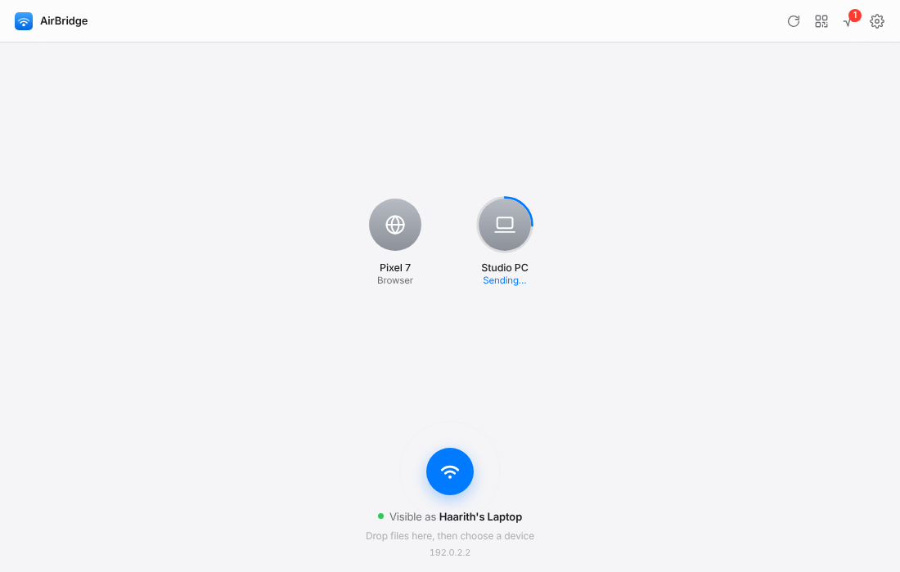
  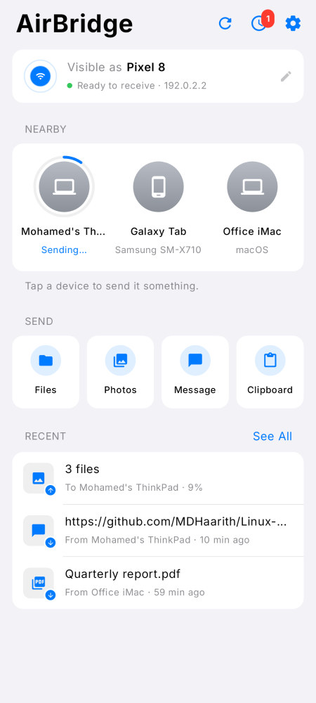
</p>

AirBridge speaks the open **[LocalSend](https://github.com/localsend/localsend) v2 protocol**, so it
also works with the official LocalSend apps (Windows, macOS, iOS, Android, Linux). The Linux app
also speaks **Google Quick Share**, so a stock Android phone with no app installed can share to
your computer from its own share sheet, just like an iPhone with a Mac. Background: **[docs/RESEARCH.md](docs/RESEARCH.md)**.

## What's inside

| Part | Tech | Highlights |
|---|---|---|
| **Linux app** (`linux/`) | Rust (tokio, axum, rustls) + an embedded web UI | Radar UI, drag & drop, **Quick Share for stock Android**, **screen-edge drop zone** (KDE Plasma, wlroots, X11), tray icon, notifications with Accept/Decline, CLI, file-manager "Send with AirBridge" |
| **Android app** (`android/`) | Kotlin + Jetpack Compose | Same radar UI, **your devices in the system share sheet (Direct Share)**, a one-tap share sheet, **edge panel over any app**, photo previews in notifications, Quick Settings tile, background receiving |
| **Phone browser companion** | Served by the Linux app | A phone with *no app at all* scans a QR code and shares through its browser |

### Like AirDrop on a Mac

**Share from any Android phone, no app needed.** AirBridge shows up in Android's built-in
*Quick Share* sheet like any Chromebook or Windows PC. Pick it, check that the four-digit PIN
matches the one on your computer, accept, done. Links open with one click from the
notification. When you send *to* a phone, AirBridge wakes nearby phones over Bluetooth (BlueZ)
so they appear as targets.

**Drag to the edge of the screen.** Drag an image out of a web page, files out of Dolphin, or a
piece of text to the right edge of the screen. A card slides out with your devices. Drop it on
one and it's sent. Images come straight from the browser in their original format, and web
links are downloaded first when they point to a file.

<p align="center">
  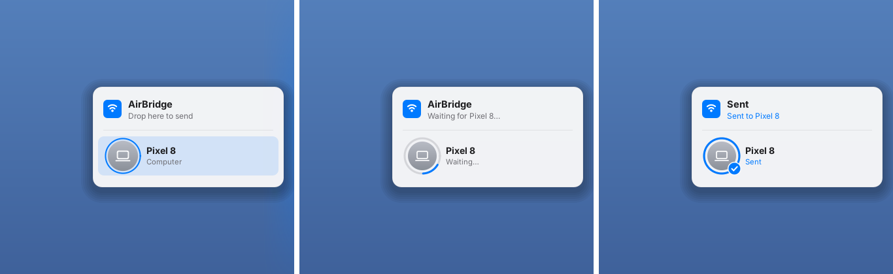
</p>
**And from the phone.** Your computers show up in the first row of Android's own share sheet
(Direct Share), like AirDrop on an iPhone. Tap one and a small sheet sends it right there, with a
progress ring, then folds away. Or turn on the **edge panel**: a slim handle on the side of the
screen, over any app, that sends your clipboard, your latest photo, or whatever you drop on it.
Received photos show up as a preview in the notification.

<p align="center">
  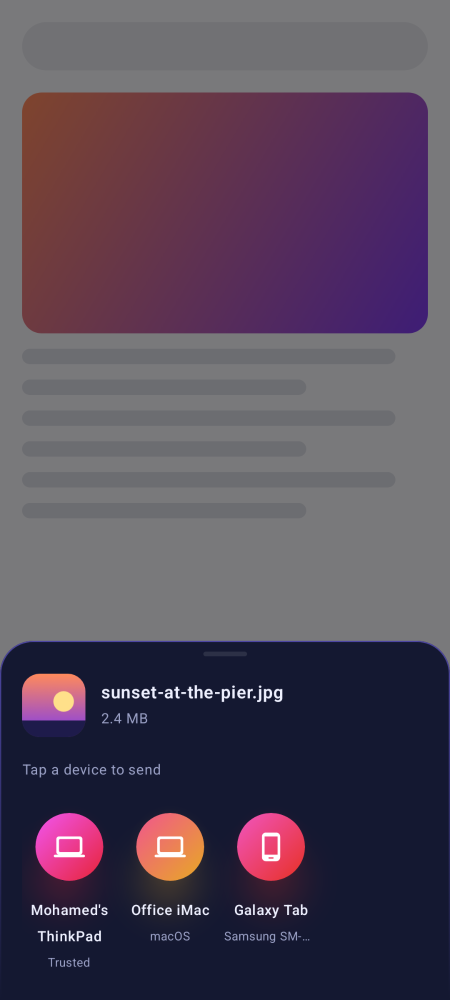
  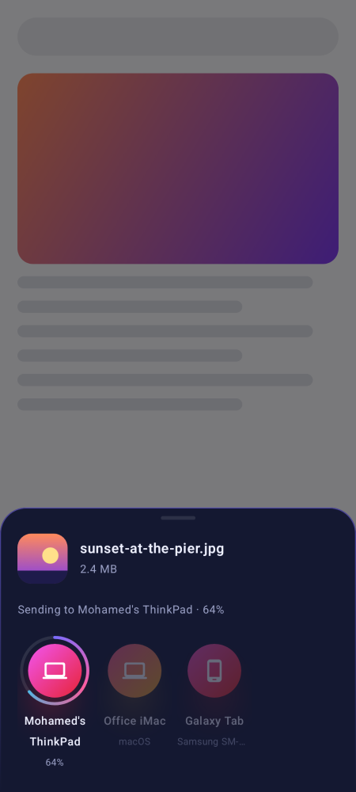
  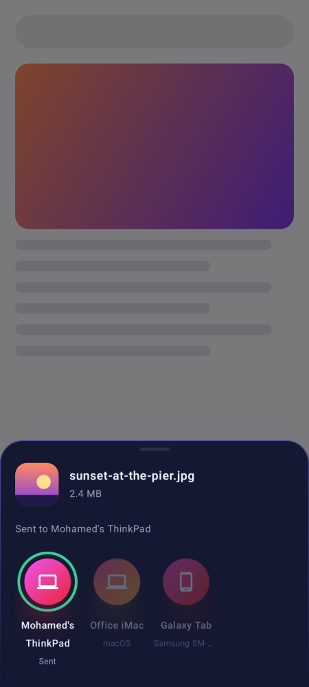
  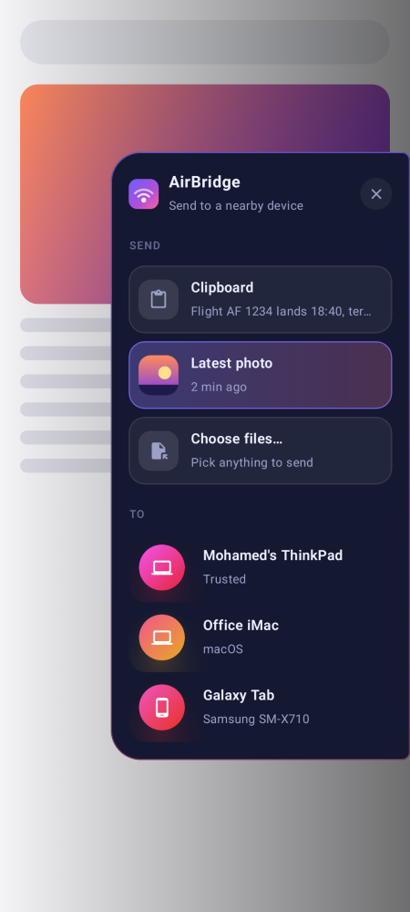
</p>

<p align="center">
  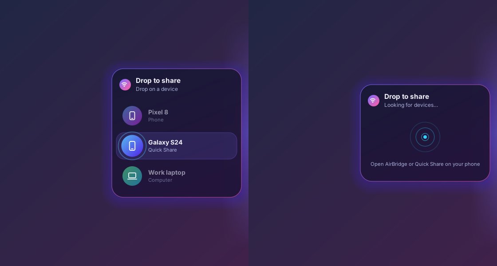
  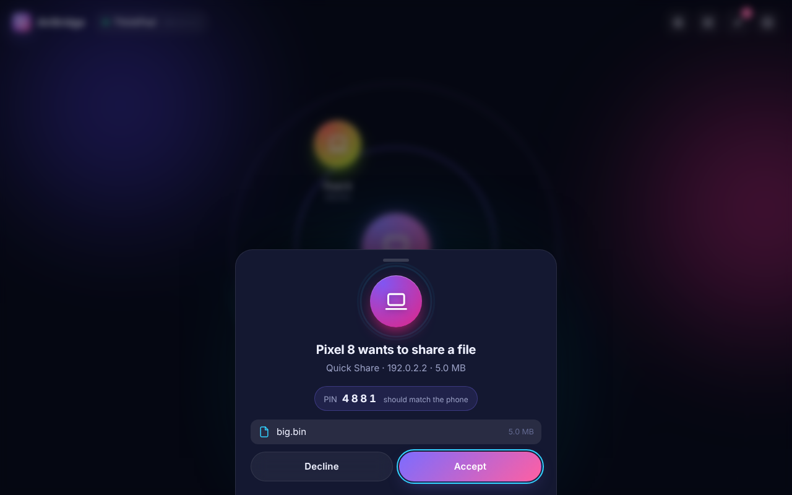
</p>

### Features

- **Find devices automatically**: multicast discovery on your Wi‑Fi, with a "Scan network"
  fallback for routers that block multicast.
- **Files, folders, photos, text and clipboard**, in both directions. Folders keep their structure.
- **Accept or decline** from the app or straight from the notification. **Trusted devices** (your
  own phone) are accepted automatically.
- **Animations everywhere**:
  - Pulse rings and a radar sweep
  - Device bubbles that spring in, float and glide into place
  - Gradient progress rings and particles flowing between devices during a transfer
  - Confetti when a transfer finishes, shake on failure, spring-animated sheets
  - Reduced-motion settings are respected
- **Secure by default**: TLS everywhere, certificates pinned by fingerprint, mutual TLS, an
  optional PIN, and the clipboard only accepts text from trusted devices.

<table>
<tr>
<td>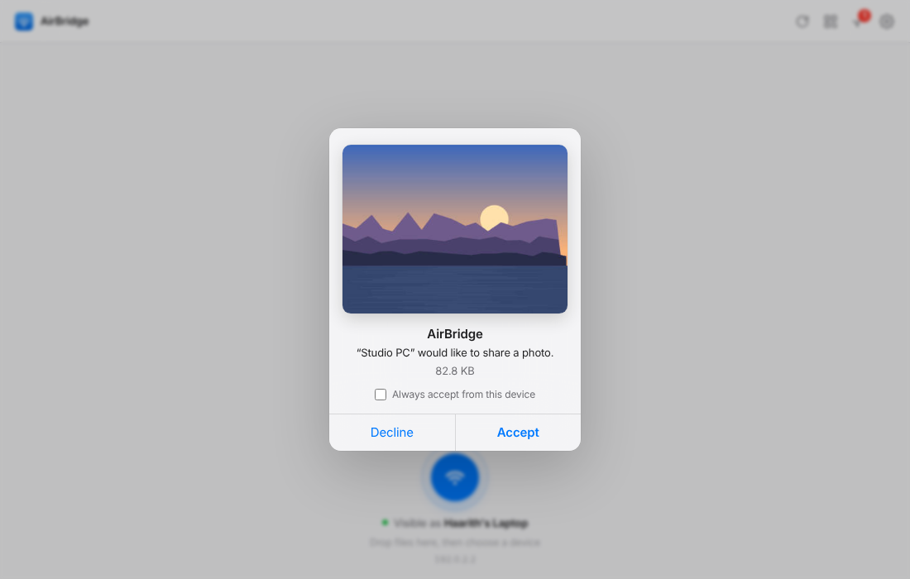</td>
<td>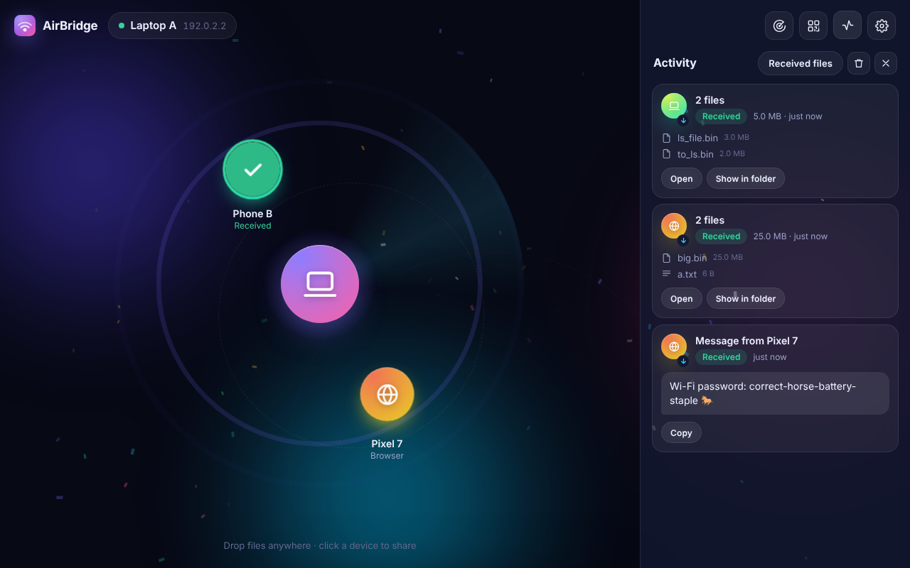</td>
</tr>
<tr>
<td>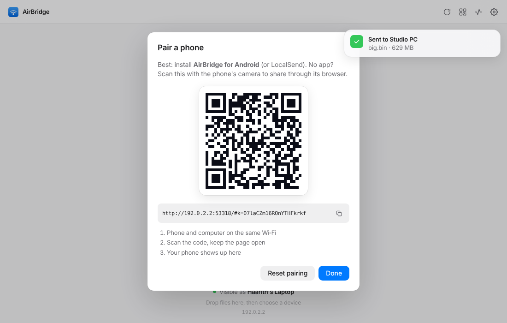</td>
<td>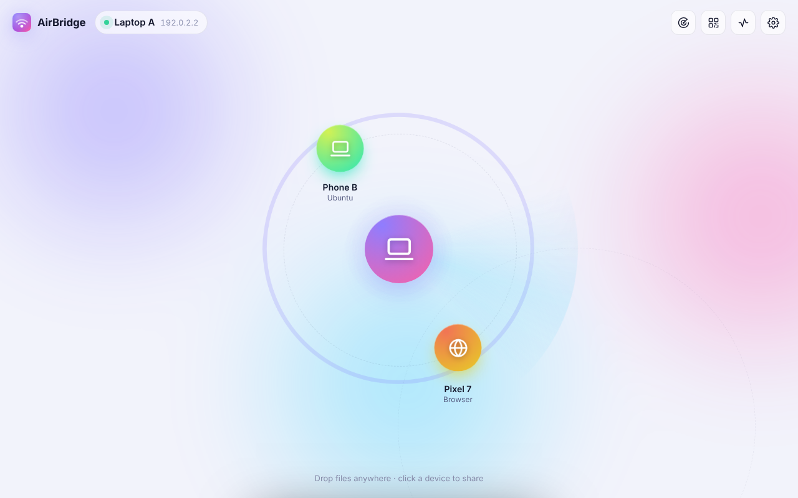</td>
</tr>
</table>

<p align="center">
  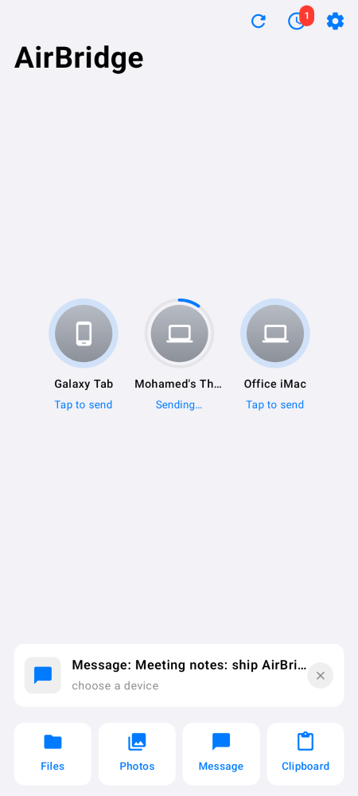
  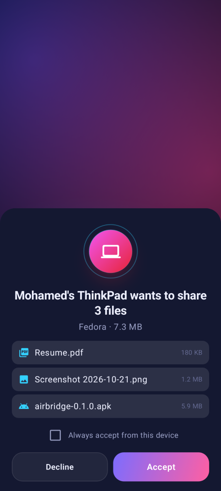
  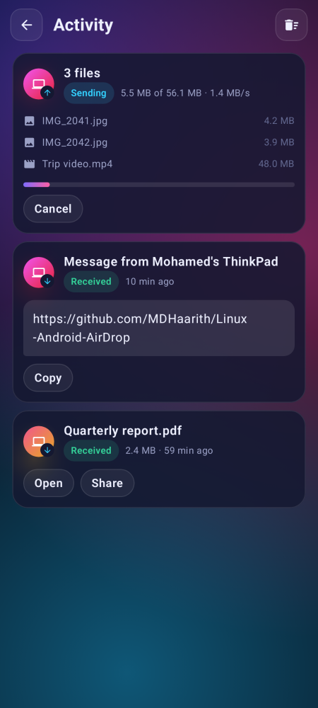
  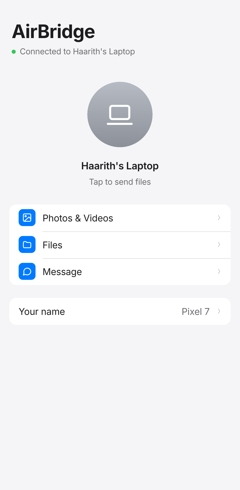
  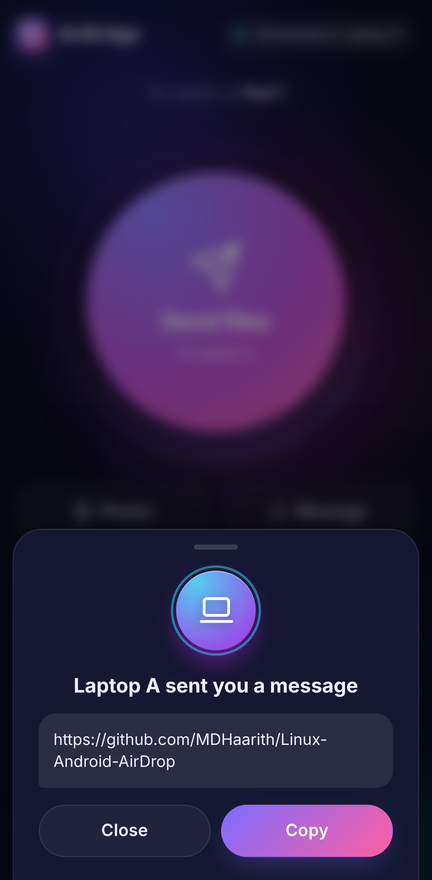
</p>

## Install

### Linux

You need [Rust](https://rustup.rs) 1.89 or newer and the Wayland client headers
(`libwayland-dev` / `wayland-devel`, used by the file picker). For a native app window, also
install WebKitGTK. Without it, AirBridge opens in a Chromium app window or your default browser.

```bash
# Debian/Ubuntu (optional: native window + screen-edge drop zone)
sudo apt install libwayland-dev libwebkit2gtk-4.1-dev libgtk-3-dev libxdo-dev libgtk-layer-shell-dev
# Fedora:  sudo dnf install wayland-devel webkit2gtk4.1-devel gtk3-devel libxdo-devel gtk-layer-shell-devel
# Arch:    sudo pacman -S webkit2gtk-4.1 gtk3 xdotool gtk-layer-shell

git clone https://github.com/MDHaarith/Linux-Android-AirDrop
cd Linux-Android-AirDrop/linux
./packaging/install.sh
```

The installer puts `airbridge` in `~/.local/bin` and adds:

- an app-menu entry
- autostart at login (it stays visible to your phone in the background)
- a tray icon
- "Send with AirBridge" in Nautilus, Dolphin and Nemo

If a firewall is active, the installer prints the exact commands to open the ports. You can also
open them yourself:

```bash
sudo ufw allow 53317/tcp && sudo ufw allow 53317/udp && sudo ufw allow 53318/tcp
sudo ufw allow 53319/tcp && sudo ufw allow 5353/udp    # Quick Share
```

Optional tools: `wl-clipboard` (Wayland) or `xclip`/`xsel` (X11) for clipboard sharing, and
`xdg-desktop-portal` or `zenity` for the file picker.

### Android (10 or newer)

Download the APK from a [release](../../releases) or from the latest CI run (artifact
`airbridge-android-apk`), or build it yourself:

```bash
cd android
./gradlew assembleRelease   # → app/build/outputs/apk/release/app-release.apk
```

Install it, open it once and allow notifications. AirBridge keeps a small "Visible as …"
notification while it can receive. Turn it off from the notification or the Quick Settings tile.

### No app on the phone?

Click the **QR** button in the desktop app and scan it with the phone's camera. A page opens that
can send files, photos and messages to the computer, and receive from it. The QR code carries a
secret key, so only someone who can see your screen can connect.

## Using it

**Desktop**

- **Drop files** anywhere in the window and release over a device to send, or drop first and
  click a device after.
- **Click a device** to send files, a folder, a message or the clipboard, or to trust it.
- Incoming requests slide up with **Accept / Decline**. The desktop notification has the same
  buttons.
- The tray icon offers *Open*, *Send clipboard to …*, *Open received files* and *Quit*.

**From anywhere**

- **Drag to the screen edge** (right by default; Settings → *Screen-edge drop zone*). The drop
  zone is a thin invisible strip that only reacts to drags, so scroll bars at the screen edge
  keep working. It needs KDE Plasma (or another wlroots/layer-shell compositor) on Wayland, or
  any X11 desktop. GNOME on Wayland can't host it.

**From a stock Android phone (Quick Share)**

- *Share → Quick Share* and pick your computer. Compare the PIN, accept on the computer, done.
  On the phone, set Quick Share's visibility to *Everyone* (temporarily is fine): *Contacts* and
  *Your devices* rely on Google accounts, which AirBridge doesn't have.
- To send to a phone, open Quick Share's *Receive* screen on it (or let AirBridge wake it over
  Bluetooth), and it appears on the radar like any other device.

**Command line**

```bash
airbridge                              # open the window (starts the service if needed)
airbridge send photo.jpg Docs/ --to pixel   # send right away, with a progress bar
airbridge send *.pdf                   # opens the window with files ready: click a device
airbridge text "https://example.com" --to pixel
airbridge clipboard --to pixel
airbridge devices                      # list nearby devices
airbridge quit
```

**Android**

- **Share from any app**: your devices are right in the share sheet's top row; tap one and it
  sends. Or pick *AirBridge* and tap a device in the sheet that slides up.
- **Edge panel** (Settings → *Edge panel*): a handle on the side of the screen over every app.
  Tap or swipe it for your clipboard, latest photo or files; drop text or files on it to send
  them. Drag it up or down to move it.
- Long-press the AirBridge icon for *Send to …* shortcuts to your devices.
- In the app: tap **Send files**, **Photos** or **Text**, then tap a device.
- Tap a device for more: send a message, the clipboard, or trust it.
- Received files go to **Downloads/AirBridge**. Text from trusted devices goes to your
  clipboard.

## How it works

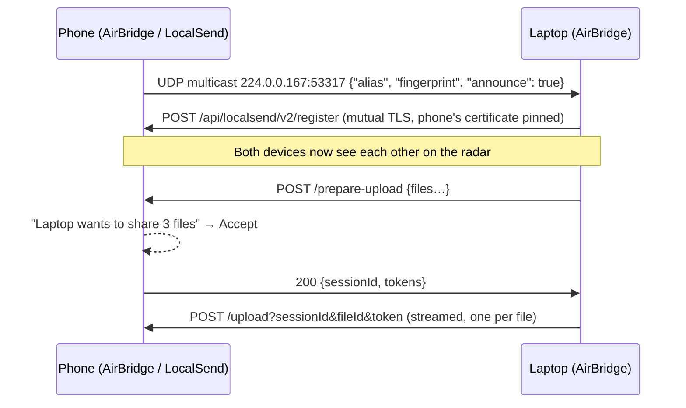

- **Identity.** Each device has a self-signed RSA certificate. Its fingerprint (SHA-256 of the
  DER, uppercase hex) is the device ID, as in LocalSend.
- **TLS.** Clients pin the fingerprint they discovered during the TLS handshake and present their
  own certificate. Servers check that a device's claimed fingerprint matches its certificate.
- **Text.** A short message is a single `text/plain` "file" with the text in `preview`, and is
  answered with `204`.
- **Ports.** 53317 TCP+UDP is the LocalSend protocol, and 53318 TCP is the phone browser
  companion (plain HTTP plus the QR key). 53319 TCP plus mDNS (5353 UDP) is Quick Share. The
  desktop UI runs on `127.0.0.1` only, behind a random token.

### Quick Share

AirBridge implements the Wi‑Fi LAN part of Google's Nearby Connections / Nearby Share protocol in
Rust (`linux/src/quickshare/`), from the protobuf definitions and NearDrop's write-up:

- **Discovery**: an mDNS service `_FC9F5ED42C8A._tcp` whose name encodes a random endpoint ID and
  whose TXT record carries the device name and type. Phones only advertise while receiving; the
  Bluetooth LE advertisement for service `0xFE2C` asks nearby phones to start.
- **Handshake**: UKEY2 with P-256 ECDH. Both sides derive AES-256-CBC + HMAC-SHA256 keys
  (SecureMessage) and a four-digit PIN shown on both screens.
- **Transfer**: length-prefixed protobuf frames with sequence numbers; files stream in 512 KB
  payload chunks, with keep-alives every 10 seconds.

The key derivation is checked against an independent Python implementation
(`linux/tools/quickshare_kat.py`), and a loopback test drives the real client into the real
server.

### Screen-edge drop zone

`airbridge edge` is a small GTK 3 process the service starts and restarts. On Wayland it is a
layer-shell surface anchored to the screen edge; on X11 a dock window. Only a 3‑pixel strip takes
input, and it steps aside when the pointer merely passes over it. When a drag arrives, it asks
the drag source for the best format (file list, original image bytes, URL, text), and sends it
through the local API. URLs are downloaded by the service; web pages are sent as links.

## Works with LocalSend

The Linux app was tested against **LocalSend's own Rust CLI**, built from the official
repository. Both directions worked: discovery, mutual TLS, files (byte-identical) and text
messages. So you can mix and match: AirBridge on Linux with LocalSend on your phone, or AirBridge
on Android with LocalSend on Windows or a Mac.

## Troubleshooting

| Problem | Fix |
|---|---|
| Devices don't show up | Put both devices on the same Wi‑Fi (not a guest network with "client isolation"). Press **Scan network**. Check the firewall ports above. |
| "Port 53317 is busy" | The official LocalSend app is running on the same computer. AirBridge then uses the next free port automatically. |
| Phone receives nothing in the background | Some vendors kill background apps. Exclude AirBridge from battery optimization. |
| No tray icon on GNOME | Install the *AppIndicator and KStatusNotifierItem Support* extension. |
| The computer doesn't show up in Quick Share | Set the phone's Quick Share visibility to *Everyone*, keep both on the same Wi‑Fi, and allow 53319/tcp and 5353/udp. Some routers block mDNS between Wi‑Fi and Ethernet. |
| Phones don't appear when sending over Quick Share | Open *Quick Share → Receive* on the phone, or make sure Bluetooth is on so AirBridge can wake it. |
| No drop zone at the screen edge | It needs the `edge` build feature (`libgtk-layer-shell-dev`), and KDE Plasma/wlroots on Wayland or any X11 desktop. Check Settings → *Screen-edge drop zone*. |
| Wrong PIN or "PIN required" | The receiver has a PIN set in its settings. AirBridge asks you for it and remembers it. |

## Development

```bash
# Linux
cd linux
cargo test && cargo clippy --all-targets -- -D warnings
cargo test --features edge edge::            # drop-zone logic + renders to target/edge-snapshots
cargo build --features edge --examples && tools/edge-e2e.sh /tmp/shots   # real drag & drop under Xvfb
AIRBRIDGE_HOME=/tmp/ab cargo run -- daemon   # isolated settings/downloads, logs: AIRBRIDGE_LOG=debug
AIRBRIDGE_EDGE_PREVIEW=1 cargo run --features edge -- edge   # show the drop zone without dragging

# Android: unit tests, the interop test against the real Linux binary, and screenshot tests
cd android
AIRBRIDGE_LINUX_BIN="$PWD/../linux/target/debug/airbridge" ./gradlew testDebugUnitTest
./gradlew recordPaparazziDebug               # render the screens to PNG (app/src/test/snapshots), no emulator needed
```

Things worth knowing:

- **The networking core is shared and testable.** The Android engine depends only on a small
  `Platform` interface: storage, clipboard and the multicast lock. So the same Kotlin code runs in
  JVM tests against the Rust binary. The interop test covers discovery, files and folders both
  ways, text and clipboard, auto-accept for trusted devices, and declining.
- **The desktop UI** is plain HTML/CSS/JS in `linux/ui/`, compiled into the binary. The native
  window (`--features webview`) uses WebKitGTK through `wry`. Without it, the same UI opens as a
  Chromium app window.

Project layout:

```
linux/      Rust service + CLI + embedded UI (ui/), packaging/
android/    Kotlin/Compose app; core/ is the protocol engine, ui/ the screens
docs/       RESEARCH.md, screenshots
```

## License

MIT. See [LICENSE](LICENSE). AirBridge is not affiliated with Apple, Google or the LocalSend
project.
